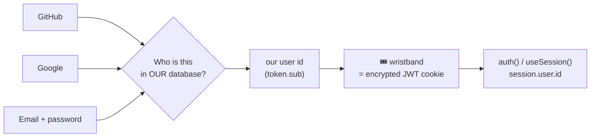
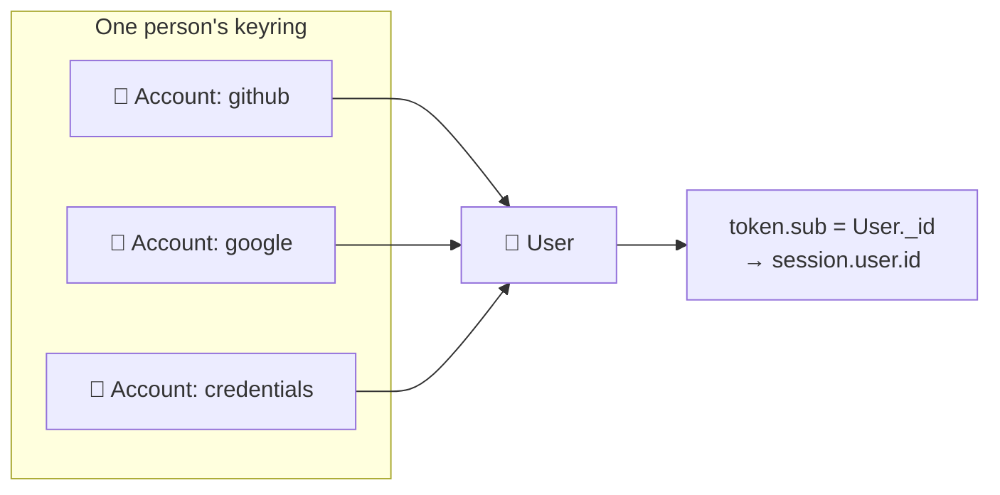
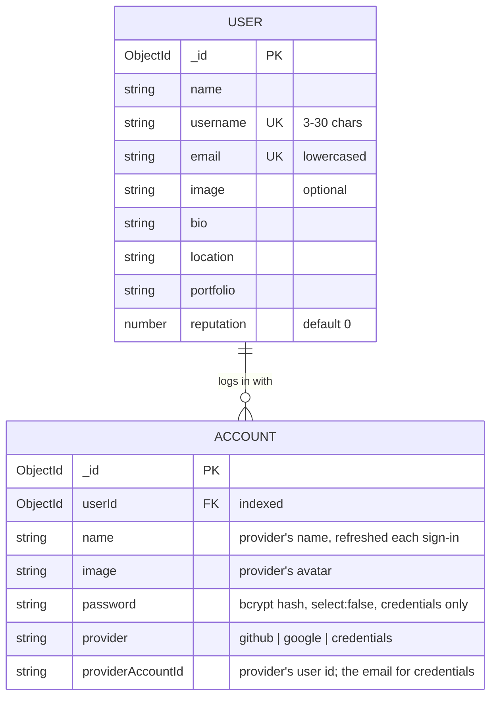
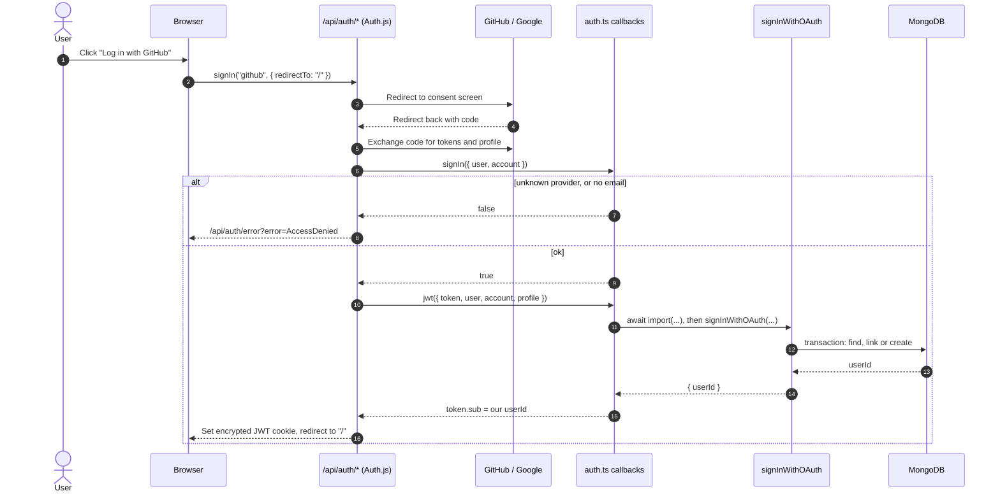
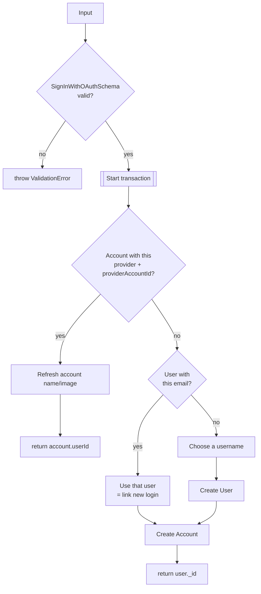
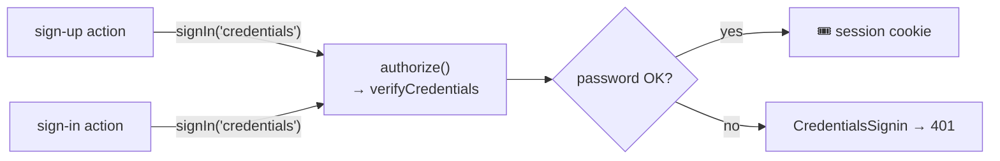
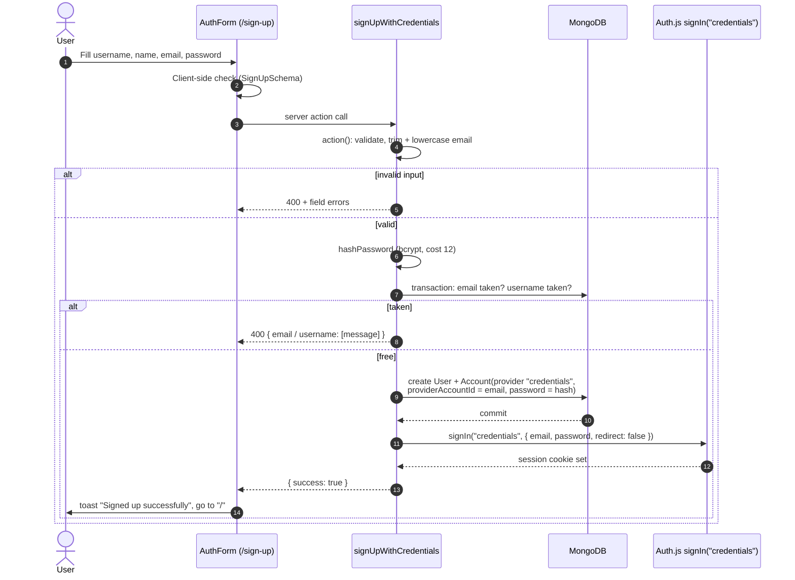
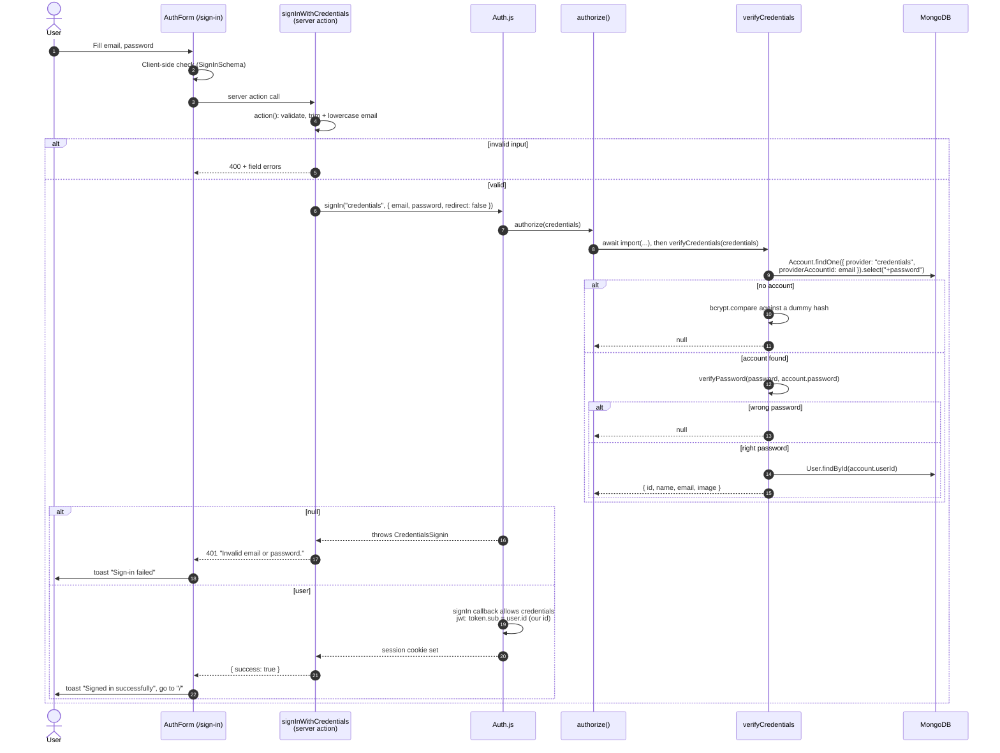
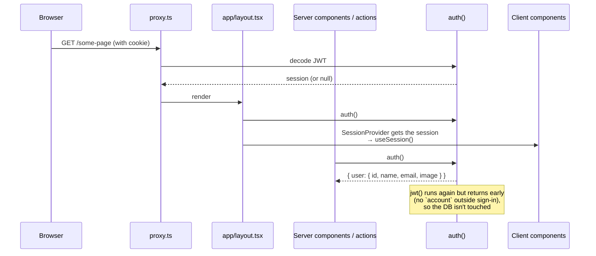

# Auth layer

How users sign in to DevFlow, where their data lives, and how the rest of the
app finds out who is signed in.

**Stack:** Auth.js v5 (`next-auth@5 beta`), JWT sessions (no database
adapter), Mongoose for users and accounts, Zod for validation, and bcrypt for
passwords.

**Status:** GitHub, Google and email/password sign-up, sign-in and sign-out
all work end to end. What's still missing is in
[Current limitations](#5-current-limitations).

## The whole thing in one picture

- A **User** is a person. An **Account** is one key on their keyring: GitHub,
  Google or a password.
- Signing in means showing any key. We follow it to the person and get **our**
  user id.
- That id goes on a **wristband**: an encrypted cookie (a JWT).
- After that, the app only glances at the wristband. It never asks which door
  you came through, and it doesn't touch the database to do it.

**Reading order:** to understand the flow, read sections 1 → 4 in order. To
look something up, jump to [Limitations](#5-current-limitations),
[Reference](#6-implementation-reference) or the [Glossary](#7-glossary).

---

## 1. Identity and data

### Person, keys, wristband

In code terms:

| Idea             | What it is in the code                                                |
| ---------------- | --------------------------------------------------------------------- |
| Person           | A `User` document (`users` collection).                               |
| Key              | An `Account` document, found by `provider` + `providerAccountId`.     |
| Wristband        | The session cookie: an encrypted JWT.                                 |
| Name on the band | `token.sub`, always **our** `User._id`, never the GitHub/Google id.   |
| Reading it       | `session.user.id`, copied from `token.sub` by the `session` callback. |

Two rules for adding keys:

- A new **GitHub/Google** key whose email we already know is **added to that
  person's keyring** (linking). See [Find, link or create](#find-link-or-create).
- A new **password** key for an email we already know is **refused**. Anyone
  could type your email, so that would hand them a key to your account.

### What each document stores

| Login type  | `provider`    | `providerAccountId`    | `password`  |
| ----------- | ------------- | ---------------------- | ----------- |
| GitHub      | `github`      | GitHub user id         | none        |
| Google      | `google`      | Google user id         | none        |
| Email/pass. | `credentials` | the email (lowercased) | bcrypt hash |

**Why the profile is on both documents:** the provider's name and image are
refreshed on the **Account** at every sign-in. The **User** keeps what the
person set on their profile, so signing in never overwrites their edits.

**All or nothing:** creating a user always means creating two documents, a
User and its first Account. They are written in a **transaction**, so there is
never a person with no key or a key with no person. Unique indexes on
`email`, `username` and `provider` + `providerAccountId` are the final guard
against duplicates.

**Source files:** `database/user.model.ts`, `database/account.model.ts`,
`constants/accounts.ts`.

---

## 2. OAuth journey (GitHub, Google)

### From provider button to session cookie

What the `jwt` callback sends to `signInWithOAuth`:

| Field               | Value                                                                                              |
| ------------------- | -------------------------------------------------------------------------------------------------- |
| `provider`          | `account.provider` (`github` or `google`)                                                          |
| `providerAccountId` | `account.providerAccountId`                                                                        |
| `user.name`         | `user.name`, else the GitHub `login`, else the part of the email before `@`. Cut to 50 characters. |
| `user.email`        | `user.email` (required: `signIn` already rejected users without one)                               |
| `user.image`        | `user.image` or `undefined`                                                                        |
| `user.username`     | The GitHub `login`, else the name. Only a suggestion; it is made into a username later.            |

If `signInWithOAuth` throws, the sign-in fails on purpose. If the callback
returned the token anyway, `token.sub` would still be the GitHub or Google id,
which isn't one of our user ids.

### Find, link or create

`signInWithOAuth` validates its input with `SignInWithOAuthSchema`, then runs
everything inside `connection.transaction(...)`. A temporary error retries the
whole function.

**Why it isn't an API route:** a public "link this GitHub id to that email"
endpoint would let anyone take over any account. Only the `jwt` callback calls
`signInWithOAuth`, after GitHub or Google has confirmed who the user is. The
file is `server-only`.

**Linking trusts the provider's email.** Google verifies emails. A GitHub
primary email may not be verified (see
[limitations](#5-current-limitations)).

### Choosing a username

Usernames must be unique and 3–30 characters. `slugify(text, { lower, strict,
trim })` keeps only `a-z`, `0-9` and `-`.

1. Slugify the suggestion (GitHub login or name). If it's at least 3
   characters, that's the base.
2. Otherwise slugify the part of the email before `@`. If it's at least 3
   characters, that's the base.
3. Otherwise the base is `user`.
4. If the base is free, use it. If not, add `-` and 4 random hex characters,
   trying up to 5 times.

| Input                      | Result                                                                 |
| -------------------------- | ---------------------------------------------------------------------- |
| `John Doe`                 | `john-doe` (or `john-doe-67b5` if taken)                               |
| `محمد`, email `x@mail.com` | slug is empty, the email part is too short, so `user` (or `user-d274`) |
| GitHub login `octocat`     | `octocat`                                                              |

### When OAuth fails

| Situation                                             | What the user sees                                                         |
| ----------------------------------------------------- | -------------------------------------------------------------------------- |
| Unknown provider, or no email                         | `signIn` returns `false`, which shows the Auth.js **AccessDenied** page.   |
| Invalid data from the provider (e.g. a bad image URL) | `ValidationError` is thrown in `jwt`, and Auth.js shows its error page.    |
| A DB error or no free username                        | The transaction is aborted, nothing is saved, and the error page is shown. |
| The user cancels the consent screen                   | Auth.js sends them back with an error, and `SocialAuthForm` shows a toast. |

**Source files:** `auth.ts`, `lib/auth/sign-in-with-oauth.ts`,
`lib/validations.ts` (`SignInWithOAuthSchema`),
`app/api/auth/[...nextauth]/route.ts`, `components/forms/SocialAuthForm.tsx`.

---

## 3. Email and password journeys

Both forms use `AuthForm`, which calls a **server action** passed in as
`onSubmit`. Server actions are public POST endpoints, so each action validates
its own input again with Zod (via `action()`), even though the form already
checked it in the browser. Emails are trimmed and lowercased before checking.

**The password is checked in exactly one place.** Neither action compares
passwords. Both call `signIn("credentials")`, and Auth.js runs the Credentials
provider's `authorize()`, which calls `verifyCredentials`:

One place to get right, and one place to harden later (for example rate
limiting).

### Sign-up

- **Hash before the transaction.** bcrypt is slow on purpose, and a
  transaction may retry. The hash shouldn't be recomputed each time.
- **Both "taken" checks are reported together** as one `ValidationError`, so
  the form shows "email exists" and "username taken" at once, each under its
  field.
- **A race between two sign-ups** that both pass the checks is caught by the
  unique indexes. `handleError` turns the duplicate-key error into a 409.
- **Sign-in runs after the commit, in its own `try`.** If it fails, the
  account still exists, so the user is told to sign in instead of seeing a
  false "sign-up failed".
- **An email that already belongs to a GitHub/Google user is rejected.**
  Linking it would let anyone who knows your email set a password on your
  account. This does reveal that the email is registered, which every
  sign-up form without email verification does.

### Sign-in

**The bouncer doesn't explain.** Different errors for "unknown email", "no
password on this account (GitHub/Google user)" and "wrong password" would
tell an attacker which emails have an account and how they log in (user
enumeration). So:

- `verifyCredentials` returns `null` for every one of them, and the action
  turns Auth.js's `CredentialsSignin` into one 401 message.
- For an unknown email, it still runs bcrypt against a dummy hash, so the
  answer takes about as long as a real check. This removes the obvious timing
  difference; it doesn't promise identical timing.
- Other errors (for example the database is down) aren't
  `CredentialsSignin`, so they go through `handleError`, are logged as real
  errors and show as a 500.

### When email/password fails

| Situation                                                  | What the user sees                                                                                |
| ---------------------------------------------------------- | ------------------------------------------------------------------------------------------------- |
| Invalid input (either form)                                | Messages under the fields (checked in the browser, then again on the server).                     |
| Sign-up: email or username taken                           | "An account with this email already exists." / "This username is already taken." under the field. |
| Sign-up: two sign-ups race                                 | 409 "Duplicate value for …" toast.                                                                |
| Sign-up: saved, but the sign-in afterwards failed          | Toast: "Your account was created, but we couldn't sign you in. Please sign in."                   |
| Sign-up: server unreachable                                | Toast: "Something went wrong. Please check your connection and try again."                        |
| Sign-in: unknown email, wrong password, or OAuth-only user | Toast "Sign-in failed: Invalid email or password." (401, the same for every cause).               |
| Sign-in: database or other server error                    | Toast with a 500 error. The real error is logged on the server.                                   |

**Source files:** `lib/actions/auth.action.ts`,
`lib/auth/verify-credentials.ts`, `lib/password.ts`, `lib/validations.ts`
(`SignInSchema`, `SignUpSchema`), `lib/handlers/action.ts`,
`components/forms/AuthForm.tsx`, `auth.ts` (Credentials provider).

---

## 4. Session and the signed-in experience

### Reading identity

There is no session table. The session is the encrypted JWT cookie, and the
`session` callback copies `token.sub` (our user id) to `session.user.id`. It
works the same for every provider:

- **OAuth:** the `jwt` callback sets `token.sub` to the id from
  `signInWithOAuth`.
- **Credentials:** Auth.js sets `token.sub` from the `id` that `authorize()`
  returned.

Where it's used:

- **Server components:** `await auth()` (`Navbar`, `LeftSidebar`,
  `MobileNavigation`, `app/layout.tsx`).
- **Server actions:** `action({ ..., authorize: true })` throws
  `UnauthorizedError` (401) when signed out.
- **Client components:** `useSession()`. The layout passes the server's
  session into `SessionProvider`, so there's no extra fetch.

**Check hard once, glance after.** Signing in is rare and slow on purpose
(bcrypt, provider round trips, database writes). Every request after that only
decrypts the cookie. `proxy.ts` runs `auth.ts` on every page request, so both
database helpers are loaded with `await import(...)` only while signing in.
Ordinary requests never load Mongoose.

### Signed-in pages

`/ask-question` and `/questions/[id]/edit` need a session. Each page calls
`auth()` and, when there's none, `redirect("/sign-in")` (the proxy doesn't
block anything). The page check is for the user: `createQuestion` and
`editQuestion` check the session again, because a server action can be
called without the page.

The edit page also checks the author: someone else's question redirects to
the question page. `editQuestion` repeats that check and answers 403
(`ForbiddenError`) when the signed-in user isn't the author. `getQuestion`,
which loads the question, needs no session: questions are public.

### Avatar and navigation

| Place                         | Signed out      | Signed in                                                    |
| ----------------------------- | --------------- | ------------------------------------------------------------ |
| Navbar                        | —               | `UserAvatar`: the picture, or initials ("Zed Avatar" → "ZA") |
| Left sidebar (tablet/desktop) | Log In, Sign Up | Log Out. "Profile" link in `NavLinks`                        |
| Mobile menu (phone)           | Log In, Sign Up | Log Out (also closes the menu). "Profile" link in `NavLinks` |

The avatar's name and picture come from the **session**, not the database.
The wristband is a photo taken at sign-in, so a profile change only shows
after the next sign-in (see [limitations](#5-current-limitations)).

`UserAvatar` uses Radix's `AvatarImage` (a plain ``), not `next/image`,
because Radix only shows the initials fallback when its own image fails to
load. `referrerPolicy="no-referrer"` is there because Google avatar URLs can
refuse requests that say which site they came from.

### Signing out

Both Log Out buttons are forms that post to one server action, `signOutUser`.
It calls `signOut({ redirectTo: "/sign-in" })`, which deletes the session
cookie and redirects. The pages then render signed out: no avatar, and Log In
/ Sign Up instead of Log Out.

There is no session row to remove from the database, because the session is
only the cookie. A copy of the token taken before sign-out stays valid until
it expires (30 days by default).

**Source files:** `auth.ts` (`jwt`, `session` callbacks), `proxy.ts`,
`app/layout.tsx`, `components/UserAvatar.tsx`,
`components/navigation/navbar/index.tsx`,
`components/navigation/LeftSidebar.tsx`,
`components/navigation/navbar/MobileNavigation.tsx`,
`lib/actions/auth.action.ts` (`signOutUser`).

---

## 5. Current limitations

| Limitation                                                                                                                                                         | Consequence                                                                                                          | Code                                                                |
| ------------------------------------------------------------------------------------------------------------------------------------------------------------------ | -------------------------------------------------------------------------------------------------------------------- | ------------------------------------------------------------------- |
| No rate limit on sign-in or sign-up attempts.                                                                                                                      | Passwords can be brute-forced.                                                                                       | `auth.ts`, `auth.action.ts`                                         |
| OAuth linking trusts the provider's email; GitHub's primary email may be unverified.                                                                               | Someone with an unverified GitHub email matching yours could be linked to your user. Fix: only link verified emails. | `sign-in-with-oauth.ts`                                             |
| No email verification for email/password sign-ups.                                                                                                                 | Anyone can register any email address.                                                                               | —                                                                   |
| bcrypt only uses the first 72 bytes, but the schema allows 100 characters.                                                                                         | Long passwords that share the first 72 bytes match each other.                                                       | `passwordSchema`                                                    |
| Session name/avatar aren't refreshed after a profile change.                                                                                                       | Stale until the next sign-in. Fix: refresh in `jwt` with `trigger === "update"`.                                     | `auth.ts`                                                           |
| Usernames are case-sensitive.                                                                                                                                      | `John` and `john` can both exist.                                                                                    | `user.model.ts`                                                     |
| No route protection in the proxy (no `authorized` callback). Only `/ask-question` and `/questions/[id]/edit` check `auth()` themselves and redirect to `/sign-in`. | Every other page is reachable signed out.                                                                            | `proxy.ts`, `ask-question/page.tsx`, `questions/[id]/edit/page.tsx` |
| `/api/*` is excluded from the proxy, and `/api/users` and `/api/accounts` don't check `auth()`.                                                                    | Those routes are public.                                                                                             | `app/api/**`                                                        |

---

## 6. Implementation reference

### File map

| File                                                  | What it does                                                                                                                                                                           |
| ----------------------------------------------------- | -------------------------------------------------------------------------------------------------------------------------------------------------------------------------------------- |
| `auth.ts`                                             | Auth.js config: GitHub, Google and Credentials providers; `signIn`, `jwt`, `session` callbacks. Exports `handlers`, `auth`, `signIn`, `signOut`.                                       |
| `app/api/auth/[...nextauth]/route.ts`                 | Mounts Auth.js at `/api/auth/*`.                                                                                                                                                       |
| `proxy.ts`                                            | Next 16 proxy (formerly middleware). Runs `auth` on page requests; skips `/api`, `_next`, images and icons.                                                                            |
| `lib/auth/sign-in-with-oauth.ts`                      | Server-only. Find, link or create the User and Account behind an OAuth login.                                                                                                          |
| `lib/auth/verify-credentials.ts`                      | Server-only. Checks an email/password login; returns the user or `null`.                                                                                                               |
| `lib/actions/auth.action.ts`                          | Server actions: `signUpWithCredentials`, `signInWithCredentials`, `signOutUser`.                                                                                                       |
| `lib/actions/question.action.ts`                      | `createQuestion` and `editQuestion` need a signed-in user (`authorize: true`). The author is `session.user.id`, and only the author can edit (403 otherwise). `getQuestion` is public. |
| `lib/password.ts`                                     | `hashPassword` (bcrypt, cost 12) and `verifyPassword`. The only file that touches bcrypt.                                                                                              |
| `lib/validations.ts`                                  | `SignInSchema`, `SignUpSchema`, `SignInWithOAuthSchema`, shared `emailSchema`.                                                                                                         |
| `lib/handlers/action.ts`                              | `action()`: validates input, checks the session with `authorize: true`, connects to the DB. Throws on problems.                                                                        |
| `constants/accounts.ts`                               | `OAUTH_PROVIDERS` and `ACCOUNT_PROVIDERS`. Free of Mongoose, so client code can import it.                                                                                             |
| `database/user.model.ts`, `database/account.model.ts` | The two collections (see [section 1](#1-identity-and-data)).                                                                                                                           |
| `components/forms/AuthForm.tsx`                       | Sign-in/sign-up form: runs the action, shows field errors and toasts, redirects to `/`.                                                                                                |
| `components/forms/SocialAuthForm.tsx`                 | GitHub/Google buttons; call `signIn(provider)` from `next-auth/react`.                                                                                                                 |
| `components/UserAvatar.tsx`                           | Round avatar linking to `/profile/<id>`, with an initials fallback.                                                                                                                    |
| `components/navigation/*`                             | Navbar avatar, and Log In / Sign Up / Log Out in the sidebar and mobile menu.                                                                                                          |
| `app/(root)/ask-question/page.tsx`                    | Redirects signed-out users to `/sign-in`.                                                                                                                                              |
| `app/(root)/questions/[id]/edit/page.tsx`             | Redirects signed-out users to `/sign-in` and non-authors to the question page.                                                                                                         |
| `app/layout.tsx`                                      | Passes the server session into `<SessionProvider>`.                                                                                                                                    |

### Public buttons vs back-office helpers

| Kind                                      | Where                           | Who can call it                             | Rule                                                   |
| ----------------------------------------- | ------------------------------- | ------------------------------------------- | ------------------------------------------------------ |
| **Rulebook**                              | `auth.ts`                       | Auth.js                                     | Decides who may sign in and what goes in the token.    |
| **Public buttons** (`"use server"`)       | `lib/actions/*.action.ts`       | **Anyone**: every export is a POST endpoint | Validate everything (`action()` + Zod); trust nothing. |
| **Back-office helpers** (`"server-only"`) | `lib/auth/*`, `lib/password.ts` | Only our server code                        | Can trust their caller. Never exposed as endpoints.    |

### Environment variables

Set in `.env.local` (see `.env.example`): `AUTH_SECRET`, `AUTH_TRUST_HOST`,
`AUTH_GITHUB_ID`, `AUTH_GITHUB_SECRET`, `AUTH_GOOGLE_ID`,
`AUTH_GOOGLE_SECRET`, `MONGODB_URI`.

### Keeping this doc in sync

- This doc describes the **current** code, not its history (Git keeps that).
  When auth code changes, update the sections that own it instead of adding a
  new section.
- Each rule has one home. Other sections give a one-line summary and link to
  it.
- After a change, check: the entry point, how the user id is found, what is
  written to the DB, what goes in the cookie, failure cases, what the user
  sees, and the limitations table. Re-check any diagram whose code changed.
- If one section grows past about 250 lines, consider moving it to its own
  file under `docs/auth/`.

---

## 7. Glossary

Plain-language meanings of the words used in this doc, in alphabetical order.

| Term                                   | Meaning here                                                                                                                                                    |
| -------------------------------------- | --------------------------------------------------------------------------------------------------------------------------------------------------------------- |
| **AccessDenied**                       | The Auth.js error page shown when our `signIn` callback returns `false`.                                                                                        |
| **Account**                            | One way a user logs in: a key on their keyring. Identified by `provider` + `providerAccountId`. See [section 1](#1-identity-and-data).                          |
| **`action()`**                         | Our helper at the start of every server action: checks the session, validates input with Zod, connects to the DB. Throws on any problem.                        |
| **`auth()`**                           | Reads and decrypts the session cookie; returns the session or `null`. Doesn't touch the DB.                                                                     |
| **Auth.js / NextAuth**                 | The auth library (`next-auth@5`). Runs OAuth and the Credentials check, and creates and reads the session cookie. Configured in `auth.ts`.                      |
| **`authorize()`**                      | The Credentials provider's function: returns our user, or `null` to reject.                                                                                     |
| **bcrypt**                             | A deliberately slow password-hashing algorithm, so guessing many passwords is expensive. Uses only the first 72 bytes of a password.                            |
| **Callback (Auth.js)**                 | A hook Auth.js calls at a fixed moment. `signIn`: may this login go ahead? `jwt`: what goes in the token? `session`: what does `auth()` return?                 |
| **Cookie**                             | A small value the browser stores and sends back on every request. Ours is encrypted and `httpOnly`, so page JavaScript can't read it.                           |
| **Cost factor**                        | How slow bcrypt is. Each +1 doubles the work. Ours is 12.                                                                                                       |
| **CredentialsSignin**                  | The error Auth.js throws when `authorize()` returns `null`.                                                                                                     |
| **Credentials provider**               | Email/password login checked by our own code instead of GitHub or Google. Its accounts have `provider: "credentials"`.                                          |
| **CSRF**                               | A trick that makes your browser send a request you didn't mean to. Auth.js endpoints and server actions have built-in protection.                               |
| **Dummy hash**                         | A bcrypt hash of a random password nobody knows, checked when an email doesn't exist so the failure isn't noticeably faster.                                    |
| **Duplicate key error (E11000)**       | MongoDB's error when a write breaks a unique index.                                                                                                             |
| **Dynamic import**                     | `await import("...")`: loads a module only when that line runs.                                                                                                 |
| **Hash**                               | A one-way scramble of a password: you can check a password against it but can't reverse it. bcrypt adds a random **salt**, so equal passwords hash differently. |
| **JWT**                                | JSON Web Token: a small signed (here also encrypted) bundle of data. Ours holds the user id, name, email and picture.                                           |
| **Linking**                            | Attaching a new GitHub/Google Account to an existing User with the same email.                                                                                  |
| **OAuth**                              | "Sign in with GitHub/Google": the provider confirms who you are and sends your profile. We never see that password.                                             |
| **Provider**                           | Where a login comes from: `github`, `google` or `credentials`.                                                                                                  |
| **`providerAccountId`**                | The user's id at the provider. For `credentials` it's the email.                                                                                                |
| **Proxy (`proxy.ts`)**                 | Next 16's name for middleware. Runs before each page request (not `/api`).                                                                                      |
| **Rate limiting**                      | Capping how many attempts someone can make in a period of time.                                                                                                 |
| **Route handler**                      | A file like `app/api/.../route.ts` that answers HTTP requests.                                                                                                  |
| **`select: false`**                    | A Mongoose field option: the field is left out of queries unless asked for with `.select("+field")`.                                                            |
| **Server action**                      | An async function in a `"use server"` file that the browser can call. Underneath it's a public POST endpoint.                                                   |
| **`server-only`**                      | An import that makes the build fail if the file ends up in browser code.                                                                                        |
| **Session**                            | "Who is signed in right now": `{ user: { id, name, email, image }, expires }`, from the decrypted cookie.                                                       |
| **`SessionProvider` / `useSession()`** | Make the session available to client components.                                                                                                                |
| **`signIn()` / `signOut()`**           | Start or end a session. Server versions come from `@/auth`; the client version from `next-auth/react`.                                                          |
| **Slug**                               | A URL-safe version of text: `"John Doe"` → `"john-doe"`.                                                                                                        |
| **`token.sub`**                        | "Subject": the user id stored in the JWT. Always our MongoDB user id.                                                                                           |
| **Transaction**                        | A group of DB writes that are saved all together or not at all.                                                                                                 |
| **Unique index**                       | A DB rule that no two documents can share a value.                                                                                                              |
| **User**                               | The person: profile data. Stored in the `users` collection.                                                                                                     |
| **User enumeration**                   | Learning which emails have accounts from different error messages or response times.                                                                            |
| **Zod schema**                         | A description of valid input. `safeParse` checks data against it and can also clean it (trim, lowercase).                                                       |
