# Auth layer

How users sign in to DevFlow, where their data lives, and how the rest of the
app finds out who is signed in.

**Stack:** Auth.js v5 (`next-auth@5 beta`), JWT sessions (no database
adapter), Mongoose for users and accounts, Zod for validation, and bcrypt for
passwords.

**Status:**

- GitHub and Google sign-in work end to end, tested with real logins.
- Email/password sign-up and sign-in work end to end.
- What's still missing is listed in [Not done yet](#8-not-done-yet).

---

## 0. Mental models (read this first)

Seven small ideas explain almost everything below. If a detail later is
confusing, come back here and find which idea it belongs to.

### 0.1 A person and their keys: User vs Account

Think of a **User** as a person and **Accounts** as the keys on their
keyring. Each key opens the same door, the person's profile.

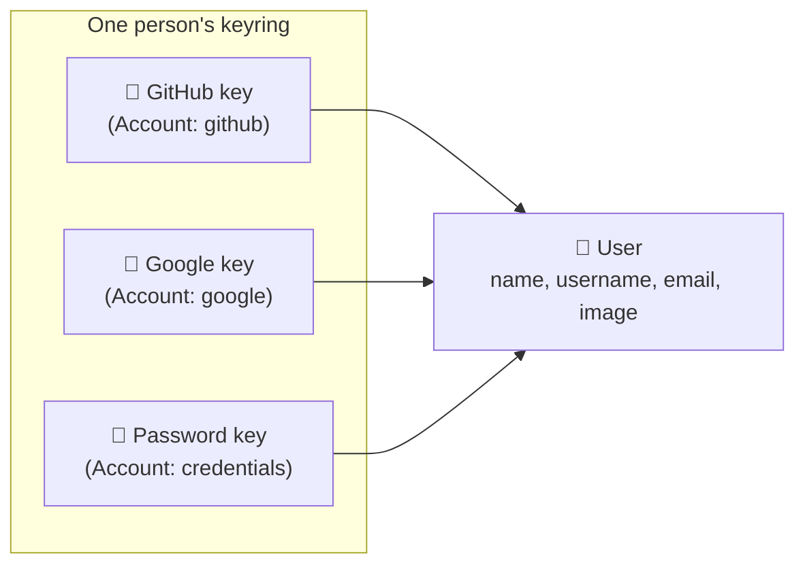

- Signing in = showing **any** key. We look up the key, then follow it to
  the person.
- A new GitHub/Google key with an email we already know is **added to that
  person's keyring** (linking).
- A new **password** key for an email we already know is **refused**.
  Anyone could type your email, so that would hand them a key to your
  account.

### 0.2 Three doors, one wristband

There are three ways in: GitHub, Google and email/password. Each one does
its own checks, but they all end the same way: we work out **our** user id
and put it on a wristband, the session cookie.

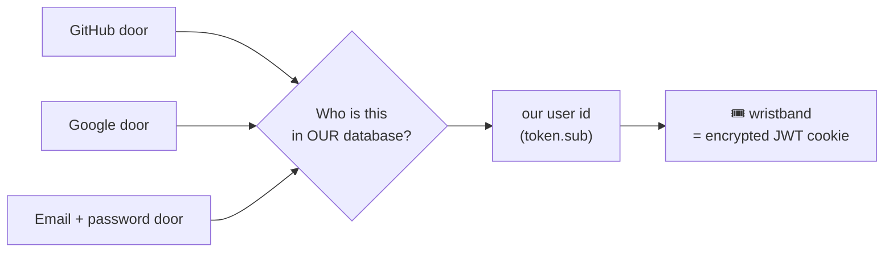

The rest of the app never asks _how_ you got in. It only reads the
wristband: `session.user.id` is always our MongoDB user id, whichever door
you used.

### 0.3 Check hard once, glance after

| Moment                  | What happens                                                                           | Touches the DB? | Speed                                 |
| ----------------------- | -------------------------------------------------------------------------------------- | --------------- | ------------------------------------- |
| **Signing in** (rare)   | Ask GitHub/Google or check the password, find or create the user, issue the wristband. | Yes             | Slow on purpose: bcrypt takes ~400 ms |
| **Every request after** | `auth()` decrypts the cookie and reads the id.                                         | **No**          | Very fast                             |

That's why the DB helpers are loaded with `await import(...)` inside the
sign-in code only. `proxy.ts` reads the wristband on every page request and
must stay light.

The flip side: the wristband is a **photo taken at sign-in**. If the user
changes their name or picture later, the avatar keeps the old photo until
they sign in again.

### 0.4 The bouncer doesn't explain

When a password sign-in fails, the bouncer says only **"Invalid email or
password."** Never "no such email" or "wrong password", and not even faster
or slower depending on why. Each hint would tell an attacker which emails
have accounts. So `verifyCredentials` returns `null` for every failure,
and it still runs bcrypt (against a dummy hash) when the email is unknown.

Sign-up can't hide this ("this email already exists"), which is normal for
sign-up forms.

### 0.5 Public buttons vs back-office helpers

| Kind                                      | Where                           | Who can call it                             | Rule                                                                    |
| ----------------------------------------- | ------------------------------- | ------------------------------------------- | ----------------------------------------------------------------------- |
| **Rulebook**                              | `auth.ts`                       | Auth.js                                     | Decides who may sign in and what goes on the wristband.                 |
| **Public buttons** (`"use server"`)       | `lib/actions/*.action.ts`       | **Anyone**: every export is a POST endpoint | Validate everything (`action()` + Zod), trust nothing from the browser. |
| **Back-office helpers** (`"server-only"`) | `lib/auth/*`, `lib/password.ts` | Only our server code                        | Can trust their caller. They are never exposed as endpoints.            |

That's why `signInWithOAuth` isn't an API route. A public "link this
GitHub id to that email" button would let anyone take over any account.

### 0.6 The password is checked in exactly one place

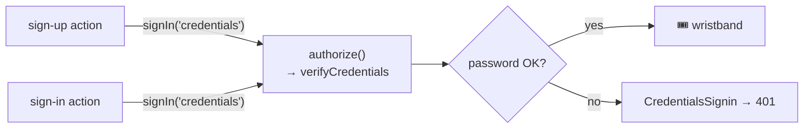

The actions never compare passwords themselves. They hand the email and
password to Auth.js, which runs `authorize()`. One place to get right, and
one place to harden later (for example rate limiting).

### 0.7 All or nothing

Creating a user always means creating **two** documents: a User and its
first Account. They are written in a **transaction**: either both are saved
or neither is, so there is never a person with no key, or a key with no
person. Slow work (bcrypt) happens **before** the transaction, because a
transaction may retry.

---

## 1. The pieces

| File                                                | What it does                                                                                                                                                                                                                             |
| --------------------------------------------------- | ---------------------------------------------------------------------------------------------------------------------------------------------------------------------------------------------------------------------------------------- |
| `auth.ts`                                           | Auth.js config: the GitHub, Google and Credentials providers, and the `signIn`, `jwt` and `session` callbacks. Exports `handlers`, `auth`, `signIn` and `signOut`.                                                                       |
| `app/api/auth/[...nextauth]/route.ts`               | Mounts Auth.js at `/api/auth/*` (sign-in, callback, session, sign-out).                                                                                                                                                                  |
| `proxy.ts`                                          | Next 16 proxy (formerly middleware). It runs `auth` on every page request so the session is available. It skips `/api`, `_next`, images and icons.                                                                                       |
| `lib/auth/sign-in-with-oauth.ts`                    | Server-only. Finds or creates the User and Account behind a GitHub or Google login, in a transaction.                                                                                                                                    |
| `lib/auth/verify-credentials.ts`                    | Server-only. `verifyCredentials` checks an email/password login and returns the user or `null`. It takes the same time whether or not the email exists. Only `authorize()` calls it.                                                     |
| `lib/actions/auth.action.ts`                        | Server actions. `signUpWithCredentials` creates the User and a `credentials` Account in a transaction, then signs the user in. `signInWithCredentials` signs in with email and password. `signOutUser` signs out and goes to `/sign-in`. |
| `lib/password.ts`                                   | `hashPassword` (bcrypt, cost 12) and `verifyPassword`.                                                                                                                                                                                   |
| `lib/validations.ts`                                | `SignInSchema`, `SignUpSchema` and `SignInWithOAuthSchema`. Emails are trimmed and lowercased before they are checked.                                                                                                                   |
| `constants/accounts.ts`                             | `OAUTH_PROVIDERS` (`github`, `google`) and `ACCOUNT_PROVIDERS` (adds `credentials`). It is free of Mongoose, so client code can import it.                                                                                               |
| `database/user.model.ts`                            | The person: profile data, plus a unique `username` and `email`.                                                                                                                                                                          |
| `database/account.model.ts`                         | One login method for a user. Unique on `(provider, providerAccountId)`. `password` is `select: false`.                                                                                                                                   |
| `lib/handlers/action.ts`                            | Server-action helper: validates input, checks the session with `authorize: true`, and connects to the DB. It throws on problems.                                                                                                         |
| `components/forms/AuthForm.tsx`                     | The sign-in/sign-up form. It runs the server action, shows field errors under the inputs, and on success shows a toast and redirects to `/`.                                                                                             |
| `components/forms/SocialAuthForm.tsx`               | "Log in with GitHub/Google" buttons. They call `signIn(provider)` from `next-auth/react`.                                                                                                                                                |
| `components/navigation/LeftSidebar.tsx`             | Uses `auth()` to pick Log Out (a form posting to `signOutUser`) or Log In / Sign Up, and passes the user id to `NavLinks`.                                                                                                               |
| `components/navigation/navbar/MobileNavigation.tsx` | The same for the phone menu. The Log Out button also closes the menu.                                                                                                                                                                    |
| `components/navigation/navbar/index.tsx`            | The navbar. Uses `auth()` to show the signed-in user's `UserAvatar`.                                                                                                                                                                     |
| `components/UserAvatar.tsx`                         | Round avatar linking to `/profile/<id>`. Shows the picture, or the initials when there is none or it fails to load.                                                                                                                      |
| `app/layout.tsx`                                    | Passes the server session into `<SessionProvider>` for client components.                                                                                                                                                                |

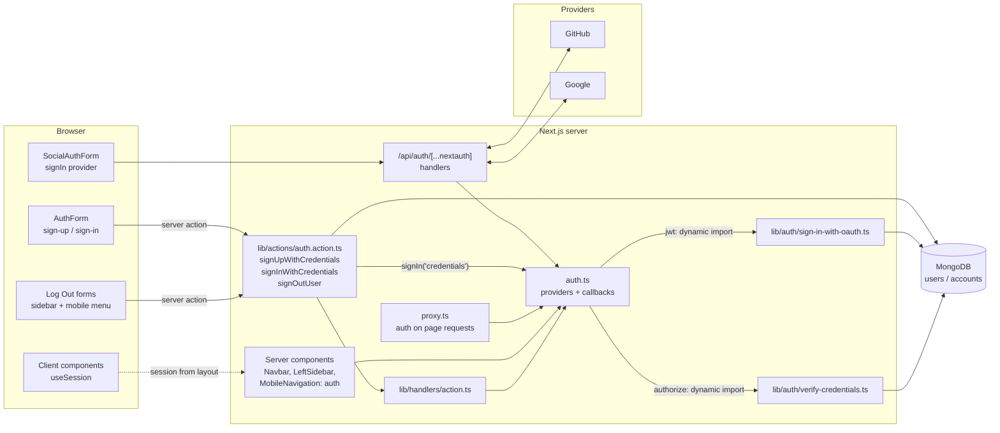

---

## 2. Data model

A **User** is a person. An **Account** is one way that person logs in. One
user can have several accounts. For example, the same email used through
GitHub and through Google gives one user with two accounts.

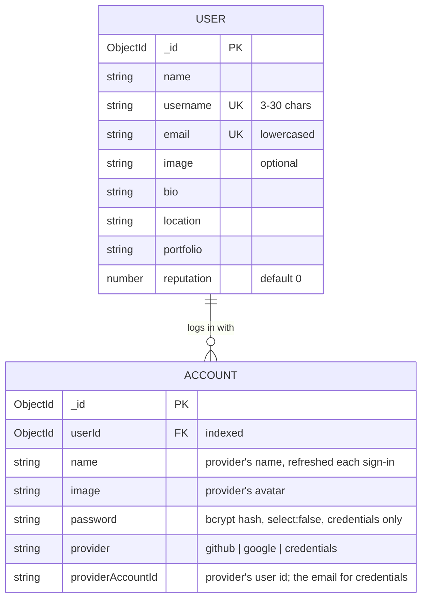

| Login type  | `provider`    | `providerAccountId`    | `password`  |
| ----------- | ------------- | ---------------------- | ----------- |
| GitHub      | `github`      | GitHub user id         | none        |
| Google      | `google`      | Google user id         | none        |
| Email/pass. | `credentials` | the email (lowercased) | bcrypt hash |

Why the profile lives on both documents: the provider's name and image are
refreshed on the **Account** at every sign-in. The **User** keeps what the
person set in their profile, so signing in never overwrites their edits.

---

## 3. OAuth sign-in, step by step

What the `jwt` callback sends to `signInWithOAuth`:

| Field               | Value                                                                                              |
| ------------------- | -------------------------------------------------------------------------------------------------- |
| `provider`          | `account.provider` (`github` or `google`)                                                          |
| `providerAccountId` | `account.providerAccountId`                                                                        |
| `user.name`         | `user.name`, else the GitHub `login`, else the part of the email before `@`. Cut to 50 characters. |
| `user.email`        | `user.email` (required: `signIn` already rejected users without one)                               |
| `user.image`        | `user.image` or `undefined`                                                                        |
| `user.username`     | The GitHub `login`, else the name. It is only a suggestion and gets slugified later.               |

If `signInWithOAuth` throws, the sign-in fails. That is on purpose: if the
callback returned the token anyway, `token.sub` would still be the GitHub or
Google id, which isn't one of our user ids.

---

## 4. Inside `signInWithOAuth`

Everything runs in `connection.transaction(...)`. A new user is never left
without an account, and temporary errors retry the whole function.

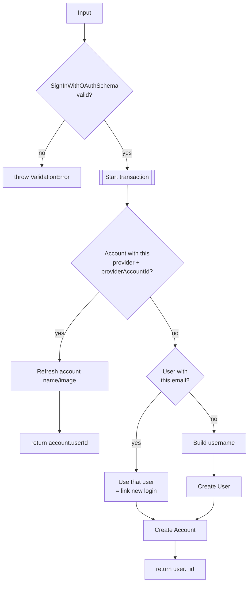

### Building the username

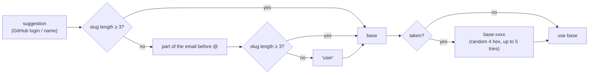

`slugify(text, { lower, strict, trim })` keeps only `a-z`, `0-9` and `-`.
Some examples:

| Input                      | Result                                                                 |
| -------------------------- | ---------------------------------------------------------------------- |
| `John Doe`                 | `john-doe` (or `john-doe-67b5` if taken)                               |
| `محمد`, email `x@mail.com` | slug is empty, the email part is too short, so `user` (or `user-d274`) |
| GitHub login `octocat`     | `octocat`                                                              |

---

## 5. Email/password sign-up

The sign-up page passes the `signUpWithCredentials` server action to
`AuthForm` as `onSubmit`. Server actions are public POST endpoints, so the
action validates its own input with `SignUpSchema`.

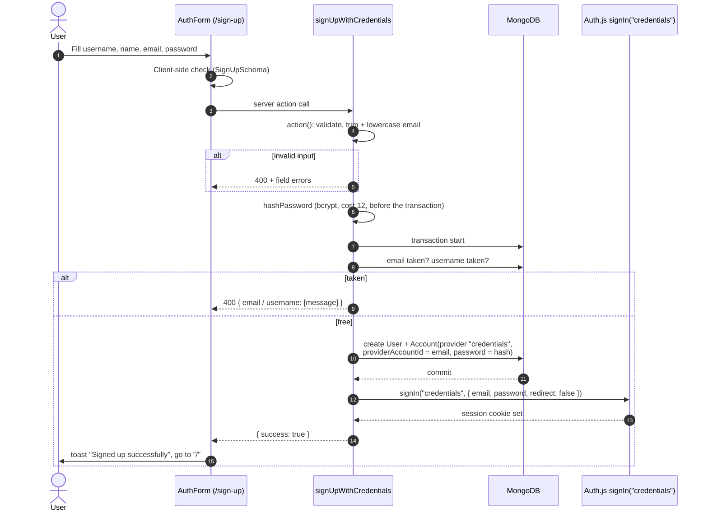

Details:

- **Hash before the transaction.** bcrypt is slow on purpose. The
  transaction may retry, and the hash shouldn't be recomputed each time.
- **Both "taken" checks are reported together** as one `ValidationError`,
  so the form can show "email exists" and "username taken" at once, each
  under its field.
- **A race between two sign-ups** that both pass the checks is caught by
  the unique indexes. `handleError` turns the duplicate-key error into a 409.
- **Sign-in runs after the commit, in its own `try`.** If it fails, the
  account still exists, so the user gets "Your account was created, but we
  couldn't sign you in" instead of a false "sign-up failed".
- **An email that already belongs to a GitHub/Google user is rejected.**
  Linking it would let anyone who knows your email set a password on your
  account.

---

## 6. Email/password sign-in

The sign-in page passes the `signInWithCredentials` server action to
`AuthForm`. The action doesn't check the password itself. It calls
`signIn("credentials")`, and Auth.js runs the Credentials provider's
`authorize()`, which calls `verifyCredentials`. So the password is checked
in exactly one place, for both sign-in and the automatic sign-in after
sign-up.

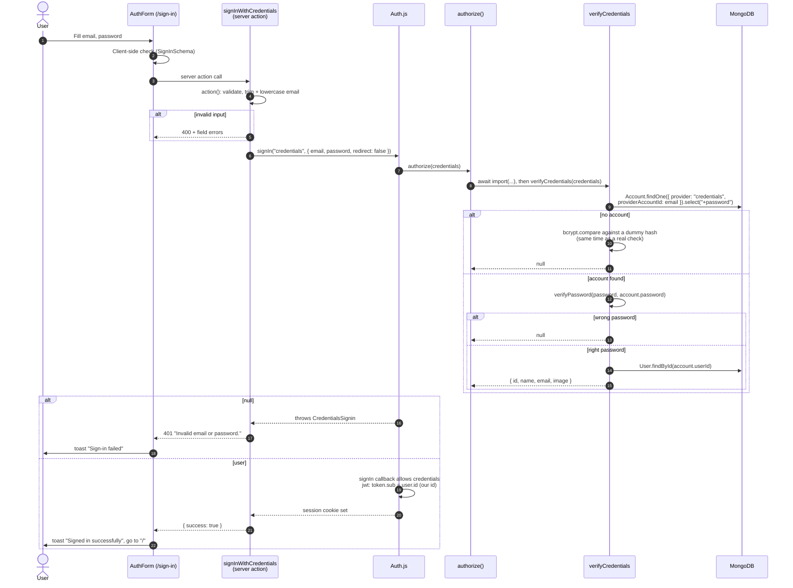

Why every failure gives the same answer: different errors for "unknown
email", "no password on this account (GitHub/Google user)" and "wrong
password" would tell an attacker which emails have an account and how they
log in.

- **Same message:** `verifyCredentials` returns `null` for all of them, and
  the action turns Auth.js's `CredentialsSignin` into one 401.
- **Same timing:** an unknown email is checked against a dummy hash. Tested:
  an unknown email and a wrong password both take about 410 ms.
- **Other errors** (for example the database is down) aren't
  `CredentialsSignin`, so they go through `handleError`. They are logged as
  real errors and show as a 500.

---

## 7. Reading the session

There is no session table. The session is an encrypted JWT in a cookie. The
`session` callback copies `token.sub` (our user id) to `session.user.id`.
This works the same for every provider:

- **OAuth:** the `jwt` callback sets `token.sub`.
- **Credentials:** Auth.js sets `token.sub` from the `id` that
  `authorize()` returned.

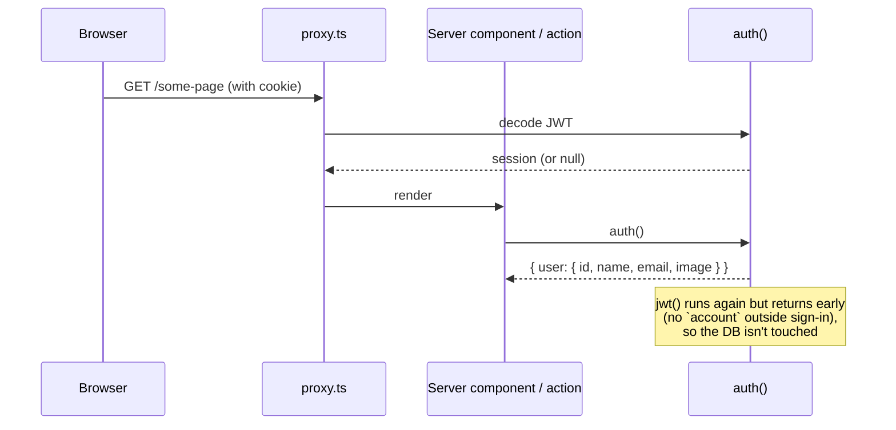

Where it's used:

- **Server components:** `const session = await auth()` (`Navbar`, `LeftSidebar`, `MobileNavigation`, `app/layout.tsx`).
- **Server actions:** `action({ ..., authorize: true })` throws `UnauthorizedError` (401) when signed out.
- **Client components:** `useSession()`, through the `SessionProvider` set up in `app/layout.tsx`.
- **Sign-out:** the `signOutUser` server action (see below).

**Keeping Mongoose out of the proxy:** `proxy.ts` runs `auth.ts` on every
page request. Both DB helpers are loaded with `await import(...)` only while
signing in, so ordinary requests never load Mongoose.

### What the signed-in user sees

| Place                         | Signed out      | Signed in                                                    |
| ----------------------------- | --------------- | ------------------------------------------------------------ |
| Navbar                        | —               | `UserAvatar`: the picture, or initials ("Zed Avatar" → "ZA") |
| Left sidebar (tablet/desktop) | Log In, Sign Up | Log Out. "Profile" link in `NavLinks`                        |
| Mobile menu (phone)           | Log In, Sign Up | Log Out. "Profile" link in `NavLinks`                        |

The avatar's name and picture come from the **session**, not the database.
They are copied into the JWT at sign-in, so a profile change only shows
after the next sign-in.

`UserAvatar` uses Radix's `AvatarImage` (a plain ``), not
`next/image`. Radix only shows the initials fallback when its own image
fails to load. `referrerPolicy="no-referrer"` is there because Google avatar
URLs can refuse requests that say which site they came from.

### Signing out

Both Log Out buttons are forms that post to one server action,
`signOutUser`.

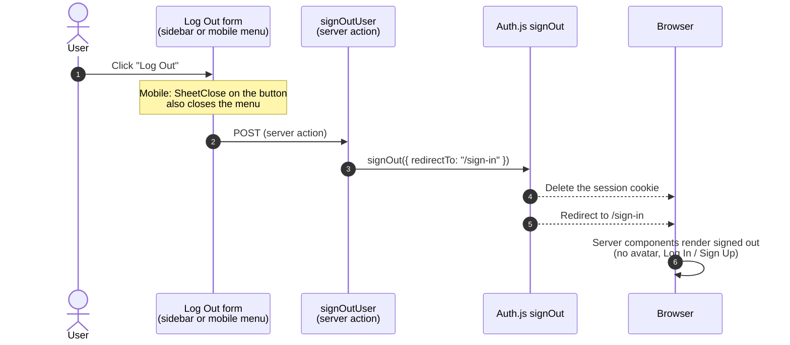

Because the session is only a cookie (JWT), signing out just deletes that
cookie. There is no session row to remove from the database. A copy of the
token taken before sign-out stays valid until it expires (30 days by
default).

---

## 8. Not done yet

| Gap                                                                                                                                                                 | Where                       |
| ------------------------------------------------------------------------------------------------------------------------------------------------------------------- | --------------------------- |
| No rate limit on login or sign-up attempts, so passwords can be brute-forced.                                                                                       | `auth.ts`, `auth.action.ts` |
| bcrypt only uses the first 72 bytes of a password, but the schema allows 100 characters.                                                                            | `passwordSchema`            |
| The avatar and name in the session don't update after a profile change until the next sign-in. Fix: refresh them in the `jwt` callback with `trigger === "update"`. | `auth.ts`                   |
| Usernames are case-sensitive: `John` and `john` can both exist.                                                                                                     | `user.model.ts`             |
| No email verification for email/password sign-ups.                                                                                                                  | —                           |
| No route protection (no `authorized` callback in the proxy).                                                                                                        | `proxy.ts`                  |
| The `/api/users` and `/api/accounts` routes don't check auth.                                                                                                       | `app/api/**`                |

---

## 9. Security notes

- **No public "link account" endpoint.** `signInWithOAuth` is deliberately
  not an API route. A public route that links any provider id to any email
  would let someone take over an account. Only the `jwt` callback calls it,
  after GitHub or Google has confirmed who the user is.
- **Email linking trusts the provider.** Google verifies emails. A GitHub
  primary email may not be verified, so someone with an unverified GitHub
  email matching yours could be linked to your user. A possible hardening:
  only link when the email is verified, for example by checking
  `profile.email_verified` for Google and the GitHub emails API for GitHub.
- **Sign-up reveals that an email is registered** ("An account with this
  email already exists"). Every sign-up form without email verification
  does this. Sign-in doesn't (see section 6).
- **`/api/*` is not protected by the proxy.** The matcher excludes `api`.
  `/api/users` and `/api/accounts` are currently public, so each route must
  check `auth()` itself before it is exposed for real.
- **The proxy doesn't block any pages.** It only attaches the session.
- **Passwords.** They are hashed with bcrypt at cost 12, and the hash is
  never read unless `.select("+password")` asks for it. Only `lib/password.ts`
  touches bcrypt.
- **Secrets.** These come from `.env.local` (see `.env.example`):
  `AUTH_SECRET`, `AUTH_TRUST_HOST`, `AUTH_GITHUB_ID`, `AUTH_GITHUB_SECRET`,
  `AUTH_GOOGLE_ID`, `AUTH_GOOGLE_SECRET` and `MONGODB_URI`.

---

## 10. Error cases

| Situation                                                           | What the user sees                                                                                |
| ------------------------------------------------------------------- | ------------------------------------------------------------------------------------------------- |
| OAuth: unknown provider, or no email                                | `signIn` returns `false`, which shows the Auth.js **AccessDenied** page.                          |
| OAuth: invalid data from the provider (e.g. a bad image URL)        | `ValidationError` is thrown in `jwt`, and Auth.js shows its error page.                           |
| OAuth: a DB error or no free username                               | The transaction is aborted, nothing is saved, and the Auth.js error page is shown.                |
| OAuth: the user cancels the consent screen                          | Auth.js sends them back with an error, and `SocialAuthForm` shows a toast.                        |
| Sign-up: invalid input                                              | Messages under the fields (checked in the browser, then again on the server).                     |
| Sign-up: email or username taken                                    | "An account with this email already exists." / "This username is already taken." under the field. |
| Sign-up: two sign-ups race                                          | 409 "Duplicate value for …" toast.                                                                |
| Sign-up: saved, but the sign-in afterwards failed                   | Toast: "Your account was created, but we couldn't sign you in. Please sign in."                   |
| Sign-up: server unreachable                                         | Toast: "Something went wrong. Please check your connection and try again."                        |
| Sign-in: invalid input                                              | Messages under the fields (browser, then server).                                                 |
| Sign-in: unknown email, wrong password, or GitHub/Google-only email | Toast "Sign-in failed: Invalid email or password." (401, the same for every cause).               |
| Sign-in: database or other server error                             | Toast with a 500 error. The real error is logged on the server.                                   |
