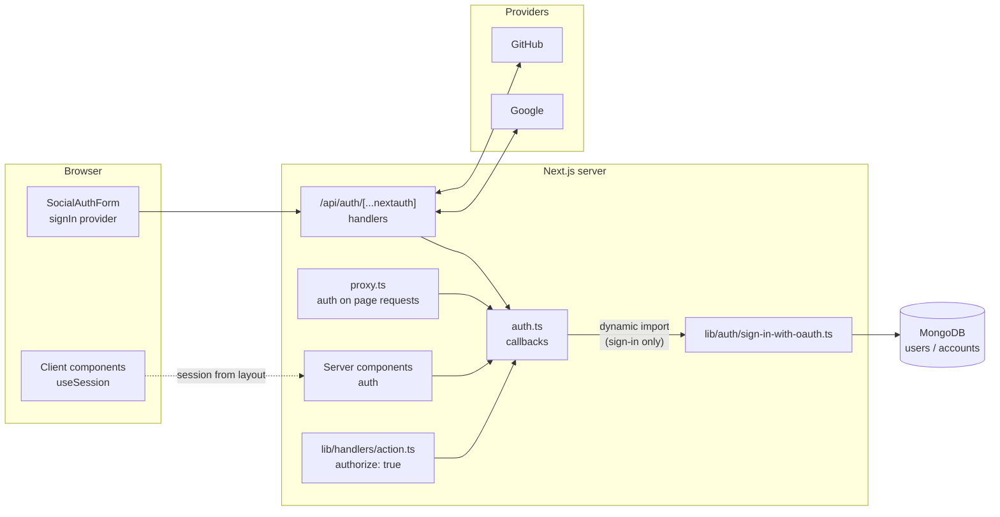
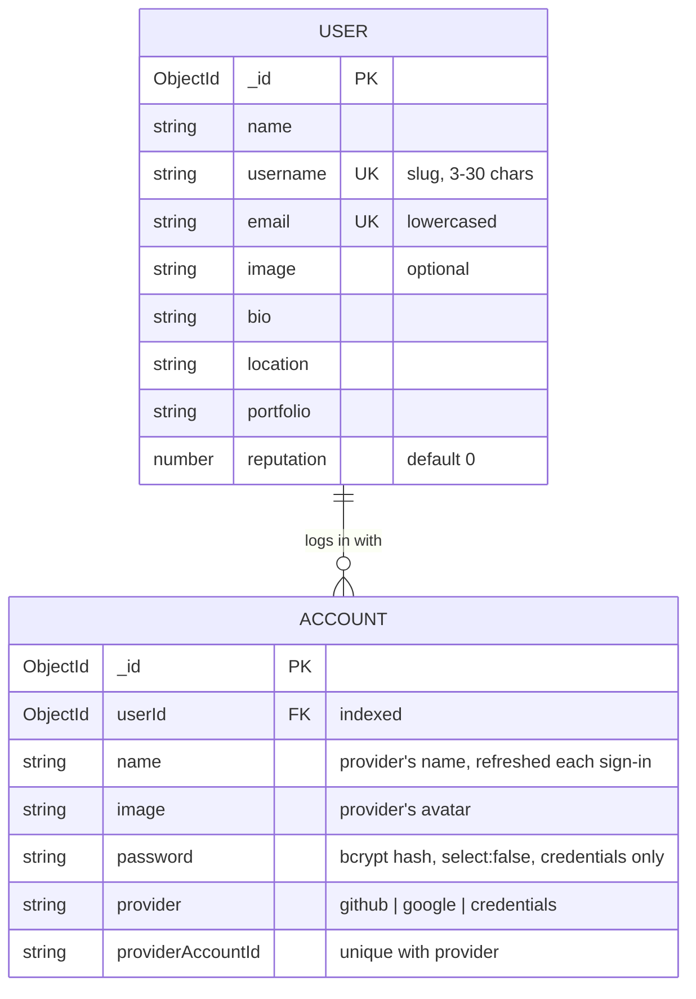
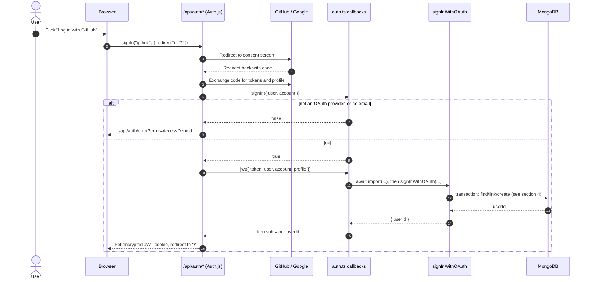
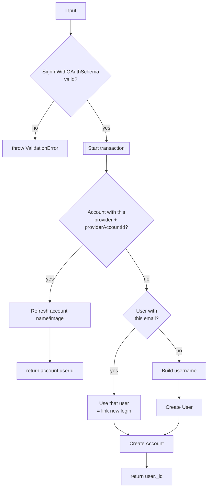
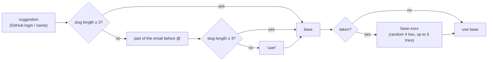
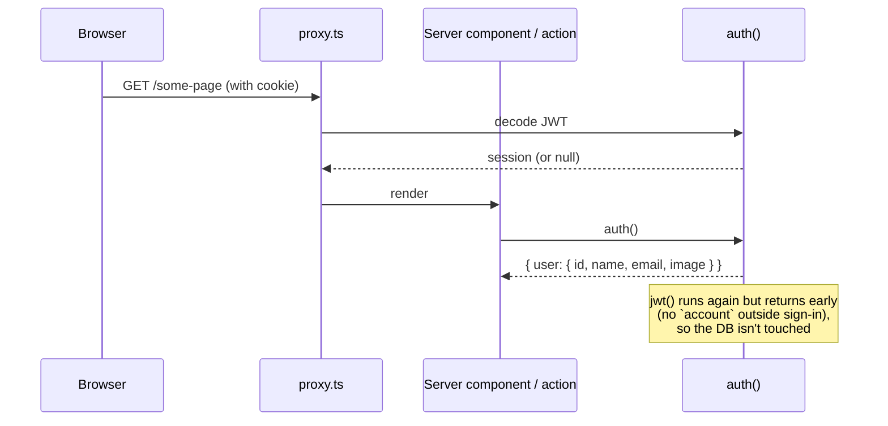

# Auth layer

How users sign in to DevFlow, where their data lives, and how the rest of the
app finds out who is signed in.

**Stack:** Auth.js v5 (`next-auth@5 beta`), JWT sessions (no database
adapter), Mongoose for users and accounts, and Zod for validation.

**Status:** GitHub and Google sign-in work end to end. Email/password
(`credentials`) is not wired up yet. See [Not done yet](#not-done-yet).

---

## 1. The pieces

| File                                    | What it does                                                                                                                                       |
| --------------------------------------- | -------------------------------------------------------------------------------------------------------------------------------------------------- |
| `auth.ts`                               | Auth.js config: providers and the `signIn`, `jwt` and `session` callbacks. Exports `handlers`, `auth`, `signIn` and `signOut`.                     |
| `app/api/auth/[...nextauth]/route.ts`   | Mounts Auth.js at `/api/auth/*` (sign-in, callback, session, sign-out).                                                                            |
| `proxy.ts`                              | Next 16 proxy (formerly middleware). It runs `auth` on every page request so the session is available. It skips `/api`, `_next`, images and icons. |
| `lib/auth/sign-in-with-oauth.ts`        | Server-only. Finds or creates the User and Account behind a GitHub or Google login, in a transaction.                                              |
| `lib/validations.ts`                    | `SignInWithOAuthSchema` (input to the function above), plus the sign-in and sign-up form schemas.                                                  |
| `constants/accounts.ts`                 | `OAUTH_PROVIDERS` (`github`, `google`) and `ACCOUNT_PROVIDERS` (adds `credentials`). It is free of Mongoose, so client code can import it.         |
| `database/user.model.ts`                | The person: profile data, plus a unique `username` and `email`.                                                                                    |
| `database/account.model.ts`             | One login method for a user. Unique on `(provider, providerAccountId)`.                                                                            |
| `lib/password.ts`                       | bcrypt hashing with cost 12, for the future credentials login.                                                                                     |
| `lib/handlers/action.ts`                | Server-action helper. `authorize: true` calls `auth()` and throws `UnauthorizedError` if nobody is signed in.                                      |
| `components/forms/SocialAuthForm.tsx`   | "Log in with GitHub/Google" buttons. They call `signIn(provider)` from `next-auth/react`.                                                          |
| `components/navigation/LeftSidebar.tsx` | Uses `auth()` to show the user, and `signOut()` for logout.                                                                                        |
| `app/layout.tsx`                        | Passes the server session into `<SessionProvider>` for client components.                                                                          |

---

## 2. Data model

A **User** is a person. An **Account** is one way that person logs in. One
user can have several accounts. For example, the same email used through
GitHub and through Google gives one user with two accounts.

Why the profile lives on both documents: the provider's name and image are
refreshed on the **Account** at every sign-in. The **User** keeps what the
person set in their profile, so signing in never overwrites their edits.

---

## 3. OAuth sign-in, step by step

What the `jwt` callback sends to `signInWithOAuth`:

| Field               | Value                                                                                              |
| ------------------- | -------------------------------------------------------------------------------------------------- |
| `provider`          | `account.provider` (`github` or `google`)                                                          |
| `providerAccountId` | `account.providerAccountId`                                                                        |
| `user.name`         | `user.name`, else the GitHub `login`, else the part of the email before `@`. Cut to 50 characters. |
| `user.email`        | `user.email` (required: `signIn` already rejected users without one)                               |
| `user.image`        | `user.image` or `undefined`                                                                        |
| `user.username`     | The GitHub `login`, else the name. It is only a suggestion and gets slugified later.               |

If `signInWithOAuth` throws, the sign-in fails. That is on purpose: if the
callback returned the token anyway, `token.sub` would still be the GitHub or
Google id, which isn't one of our user ids.

---

## 4. Inside `signInWithOAuth`

Everything runs in `connection.transaction(...)`. A new user is never left
without an account, and temporary errors retry the whole function.

### Building the username

`slugify(text, { lower, strict, trim })` keeps only `a-z`, `0-9` and `-`.
Some examples:

| Input                      | Result                                                                 |
| -------------------------- | ---------------------------------------------------------------------- |
| `John Doe`                 | `john-doe` (or `john-doe-67b5` if taken)                               |
| `محمد`, email `x@mail.com` | slug is empty, the email part is too short, so `user` (or `user-d274`) |
| GitHub login `octocat`     | `octocat`                                                              |

---

## 5. Reading the session

There is no session table. The session is an encrypted JWT in a cookie. The
`session` callback copies `token.sub` (our user id) to `session.user.id`.

Where it's used:

- **Server components:** `const session = await auth()` (`LeftSidebar`, `MobileNavigation`, `app/layout.tsx`).
- **Server actions:** `action({ ..., authorize: true })` throws `UnauthorizedError` (401) when signed out.
- **Client components:** `useSession()`, through the `SessionProvider` set up in `app/layout.tsx`.
- **Sign-out:** `signOut({ redirectTo: ROUTES.SIGN_IN })` in `LeftSidebar`.

**Keeping Mongoose out of the proxy:** `proxy.ts` runs `auth.ts` on every
page request. `sign-in-with-oauth.ts` is loaded with `await import(...)`
inside the sign-in branch only, so ordinary requests never load Mongoose.

---

## 6. Security notes

- **No public "link account" endpoint.** `signInWithOAuth` is deliberately
  not an API route. A public route that links any provider id to any email
  would let someone take over an account. Only the `jwt` callback calls it,
  after GitHub or Google has confirmed who the user is.
- **Email linking trusts the provider.** Google verifies emails. A GitHub
  primary email may not be verified, so someone with an unverified GitHub
  email matching yours could be linked to your user. A possible hardening:
  only link when the email is verified, for example by checking
  `profile.email_verified` for Google and the GitHub emails API for GitHub.
- **`/api/*` is not protected by the proxy.** The matcher excludes `api`.
  `/api/users` and `/api/accounts` are currently public, so each route must
  check `auth()` itself before it is exposed for real.
- **The proxy doesn't block any pages.** It only attaches the session. There
  is no `authorized` callback yet, so protected pages must check `auth()`
  themselves, or one should be added.
- **Passwords.** `Account.password` is `select: false`, so it is only read
  with `.select("+password")`. It is hashed with bcrypt at cost 12.
- **Secrets.** These come from `.env.local` (see `.env.example`):
  `AUTH_SECRET`, `AUTH_TRUST_HOST`, `AUTH_GITHUB_ID`, `AUTH_GITHUB_SECRET`,
  `AUTH_GOOGLE_ID`, `AUTH_GOOGLE_SECRET` and `MONGODB_URI`.

---

## 7. Not done yet

| Gap                                                                                                                 | Where                                                             |
| ------------------------------------------------------------------------------------------------------------------- | ----------------------------------------------------------------- |
| Email/password sign-in: there is no `Credentials` provider yet, and `signIn` rejects any provider that isn't OAuth. | `auth.ts`                                                         |
| The sign-in and sign-up forms submit to a stub (`Promise.resolve`).                                                 | `app/(auth)/sign-in/page.tsx`, `sign-up/page.tsx`, `AuthForm.tsx` |
| No route protection (no `authorized` callback in the proxy).                                                        | `proxy.ts`                                                        |
| The `/api/users` and `/api/accounts` routes don't check auth.                                                       | `app/api/**`                                                      |
| The OAuth flow hasn't been tested with a real GitHub or Google login yet; only the DB logic was tested directly.    | manual test on port 4317                                          |

---

## 8. Error cases

| Situation                                                    | What the user sees                                                                 |
| ------------------------------------------------------------ | ---------------------------------------------------------------------------------- |
| Provider other than GitHub/Google, or no email               | `signIn` returns `false`, which shows the Auth.js **AccessDenied** page.           |
| Invalid data from the provider (for example a bad image URL) | `ValidationError` is thrown in `jwt`, and Auth.js shows its error page.            |
| A DB error or no free username                               | The transaction is aborted, nothing is saved, and the Auth.js error page is shown. |
| The user cancels the consent screen                          | Auth.js sends them back with an error, and `SocialAuthForm` shows a toast.         |
