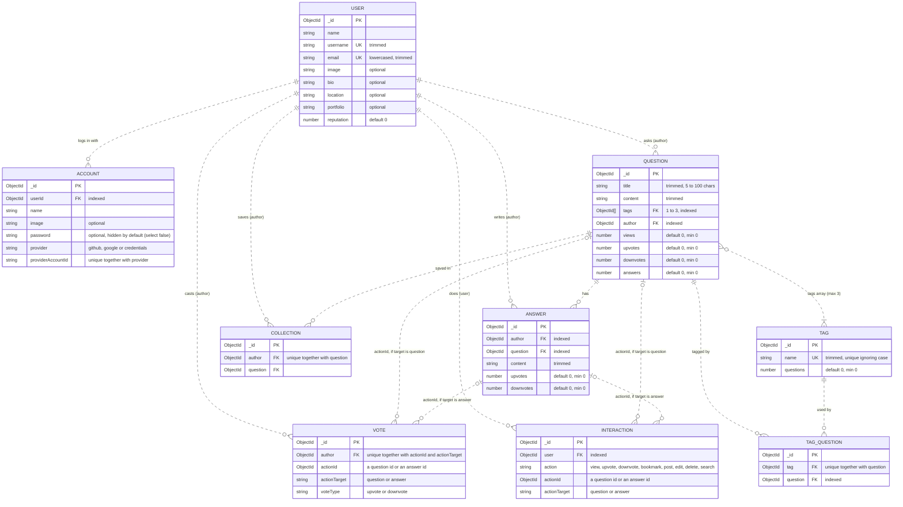

# Database model

DevFlow stores its data in MongoDB through Mongoose. Each model lives in
`database/*.model.ts`. Every document also gets `createdAt` and `updatedAt`
(`timestamps: true`) and Mongoose's version key `__v`. The diagram leaves
those out and only shows `_id`.

## Entity relationship diagram

### How to read it

- **Line ends:** `||` means exactly one, `|o` zero or one, `o{` zero or more,
  `|{` one or more. So `USER ||..o{ QUESTION` reads "a user asks zero or more
  questions; each question has exactly one author".
- **Dotted lines:** Mermaid draws a solid line when a child's identity depends
  on its parent. In MongoDB every document has its own `_id`, so none do, and
  every line is dotted.
- **Field markers:** `PK` is the primary key. `FK` is a reference to another
  model (`ref` in the schema). `UK` is unique on its own. A uniqueness that
  needs several fields together is written in the comment instead.
- **Required:** a field is required unless its comment says `optional` or
  gives a `default`.
- **Vote and Interaction:** `actionId` points at a question **or** an
  answer, and `actionTarget` says which. Each one points at exactly one of the
  two, which the diagram can't show, so it's drawn as two "zero or one" lines.
- **Nothing checks that a reference exists.** MongoDB has no foreign keys, so
  an `FK` here (or an `actionId`) can point at a deleted document. Deleting
  must clean up in code.

## The collections

| Model         | Collection     | One document is…                                       | Unique rule                                        |
| ------------- | -------------- | ------------------------------------------------------ | -------------------------------------------------- |
| `User`        | `users`        | A person and their profile.                            | `username`; `email`                                |
| `Account`     | `accounts`     | One way a user logs in (see `docs/AUTH.md`).           | `provider` + `providerAccountId`                   |
| `Question`    | `questions`    | A question, with counters for views, votes, answers.   | —                                                  |
| `Tag`         | `tags`         | A topic like `react`, with how many questions use it.  | `name`, ignoring case                              |
| `TagQuestion` | `tagquestions` | One link between a tag and a question.                 | `tag` + `question`                                 |
| `Answer`      | `answers`      | An answer to one question.                             | —                                                  |
| `Collection`  | `collections`  | A question a user saved (bookmarked).                  | `author` + `question` (save once)                  |
| `Vote`        | `votes`        | One user's up- or downvote on a question or answer.    | `author` + `actionId` + `actionTarget` (vote once) |
| `Interaction` | `interactions` | An activity log entry, used later for recommendations. | —                                                  |

## Design notes

- **Tag links are stored twice.** `Question.tags` holds the tag ids on the
  question, and `TagQuestion` holds the same links as separate documents. Both
  are indexed, so either can find "questions with this tag". Nothing in the
  schemas keeps them in step: the code that creates or edits a question must
  write both, in one transaction. `createQuestion`
  (`lib/actions/question.action.ts`) does this for new questions, and
  `editQuestion` for edits: it compares the old and new tags by lowercase
  name, adds links and `+1` for new tags, removes links and `-1` for dropped
  ones, and leaves kept tags alone.
- **The 1–3 tag rule** is a validator on `Question.tags`. It counts ids, so it
  doesn't stop the same tag twice, and array updates like `$push` skip it. The
  code must check both: `AskQuestionSchema` rejects the same tag twice
  (ignoring case), `createQuestion` saves the question with its tags in
  one `create`, and `editQuestion` sets the new list and calls `save()`, so
  the validator runs in both.
- **Counters are copies.** `Question.answers`, `upvotes`, `downvotes` and
  `Tag.questions` could be counted from other collections. `views` can't:
  `Interaction` needs a user, so signed-out views leave no record and the
  counter is the only tally. They are stored so lists don't count on every
  page load, and the code must `$inc` them
  whenever the real data changes. `min: 0` runs on create, save and validated
  updates, but **never on `$inc`**, so a decrement must guard in its filter,
  e.g. `{ answers: { $gt: 0 } }`.
- **Every model is registered on connect.** `populate("author")` looks the
  model up by name, so `User` must be registered even in a file that never
  imports it. `database/index.ts` imports every model, and `lib/mongoose.ts`
  imports that file.
- **Listing questions** (`getQuestions` in `lib/actions/question.action.ts`)
  pages with `skip`/`limit` and fetches one extra document to know if there's a
  next page, instead of a count query. Every sort ends with `_id`, so questions
  with the same date or votes keep a fixed order across pages. The search text
  is escaped before it goes into `$regex` (so `c++` is matched literally) and
  capped at 100 characters, and `pageSize` at 50. The search scans titles and
  content without an index, which is fine while the collection is small.
  Questions whose author was deleted (`author` populates to `null`) are left
  out of the list.
- **Listing tags** (`getTags` in `lib/actions/tag.action.ts`) works the
  same way: one extra document instead of a count, `_id` last in every sort,
  and an escaped search on `name`. It sorts by `popular` (question count,
  the default), `recent`, `oldest` or `name`, and runs with the tag index's
  collation so `name` sorts ignoring case ("angular" before "React"). The
  shared paging fields are `PaginatedSearchParamsSchema`; each list adds its
  own `filter` (`QuestionsSearchParamsSchema`, `TagsSearchParamsSchema`).
- **Listing users** (`getUsers` in `lib/actions/user.action.ts`) for
  `/community` works the same way: one extra document instead of a count and
  `_id` last in every sort. It sorts by `newest` (the default), `oldest` or
  `popular` (reputation). Most users have reputation 0, so `_id` is what
  keeps them in a fixed order across pages. It returns only `name`,
  `username`, `image` and `reputation` (`UserListItem`), never the email, and
  the escaped search matches `name` and `username` only: searching emails
  would let anyone check whether an address has an account.
- **A profile** (`getUser` in `lib/actions/user.action.ts`) loads one
  user's public fields only (`UserProfile`: no email) and counts their
  questions and answers with `countDocuments({ author })` (the `author`
  indexes), all three at once. A malformed ID is a 400 and an unknown user
  a 404; the `/profile/[id]` page turns both into `notFound()`. The page
  then loads only the open tab's list (`?tab=answers`), with one extra
  document for `isNext` and `_id` last in the sort:
  `getUserQuestions` (most upvoted first, built with `toQuestionCards`)
  or `getUserAnswers` (newest first, with the question's id for the
  "Read more" link). `getUserTopTags` is an aggregation on questions:
  `$match` the author, `$unwind` the tags, `$group` to count each one,
  `$lookup` its name, then the 10 most used (ties by name). Aggregations
  don't cast ids, so the ID is checked by the schema before
  `new Types.ObjectId()`.
- **One tag's questions** (`getTagQuestions` in `lib/actions/tag.action.ts`)
  loads the tag and a page of questions with `tags: tagId` (the `tags`
  index), newest first with `_id` last. It searches titles and content like
  the home page. A malformed ID is a 400 and an unknown tag a 404, which the
  `/tags/[id]` page turns into `notFound()`. Both lists build their cards
  with `toQuestionCards` in `lib/questions.ts`, which leaves out questions
  whose author was deleted, so a page can show fewer than `pageSize`.
- **One question** (`getQuestion`) populates its tags and the author's
  `name` and `image` only. A deleted author populates to `null`, which the
  page shows as "Deleted user". A malformed ID is a 400 and an unknown one a
  404; the `/questions/[id]` page turns both into `notFound()`.
- **Counting views** (`incrementViews`) is one
  `findByIdAndUpdate(id, { $inc: { views: 1 } }, { timestamps: false })`.
  `$inc` runs in the database in one step, so views at the same moment all
  count, and `timestamps: false` keeps `updatedAt` for real edits.
  `QuestionViewTracker` calls it from the browser once per question per tab
  (`sessionStorage`), so a refresh doesn't add a view. It doesn't call
  `revalidatePath`: the page shows the count it loaded with.
- **Posting an answer** (`createAnswer` in `lib/actions/answer.action.ts`)
  runs in one transaction: `$inc` the question's `answers` (with
  `timestamps: false`, like views), then create the answer. If the
  question is gone the update finds nothing, and it's a 404 with nothing
  saved. `$inc` instead of reading the count and saving it back means
  answers posted at the same time all count. It then calls
  `revalidatePath` on the question page, so the new count shows at once.
- **Listing answers** (`getAnswers` in `lib/actions/answer.action.ts`)
  loads a page of `{ question: id }` (the `question` index) with the
  author's `name` and `image`. It sorts by `latest` (the default),
  `oldest` or `popular` (`upvotes`), with `_id` last, and fetches one
  extra answer for `isNext`. It doesn't count: the page shows the
  question's stored `answers`. Unlike questions, an answer whose author
  was deleted stays in the list, with `author: null`, shown as "Deleted
  user". An unknown question just has no answers; the page has already
  called `notFound()` from `getQuestion`.
- **Voting** (`createVote` in `lib/actions/vote.action.ts`) runs in one
  transaction: load the question or answer (404 if it's gone, 403 if the
  voter wrote it), find the user's `Vote` by `author` + `actionId` +
  `actionTarget`, then create it (`+1`), delete it when it's the same way
  again (`-1`), or switch it (`-1` on the old way and `+1` on the new, in one
  `$inc`). The counts change with `timestamps: false`, like views. A `-1`
  only happens when the user's vote exists, so it never takes a count the
  vote didn't add, and no `$gt: 0` guard is needed. Two clicks at once hit the
  unique index and a write conflict; `connection.transaction()` retries, so
  each click still toggles once. The count helper isn't exported: in a
  `"use server"` file it would be a public endpoint that changes any count.
  It then revalidates the question page (an answer's vote revalidates its
  question).
- **The user's votes on a page** (`getUserVotes`) is one
  `Vote.find({ author, actionId: { $in: ids } })` for the question and the
  answers shown (at most 51 ids), using the vote index, which starts with
  `author`. Signed out, it returns no votes without a query.
- **Saving a question** (`toggleSaveQuestion` in
  `lib/actions/collection.action.ts`) needs no transaction: each step is one
  write. It first deletes the user's `Collection` row for the question; if
  one was deleted, the question is now unsaved. Otherwise it checks the
  question exists (404 if not) and creates the row. Clicks at the same
  moment can all find nothing to delete and all create: the unique
  `author` + `question` index lets one through, and the others' duplicate
  key error means "already saved", so they return `saved: true` instead of
  a 500. Unsaving works even if the question was deleted since. It then
  revalidates the question page and `/collection`.
- **Whether the user saved a question** (`hasSavedQuestion`) is one
  `Collection.exists({ author, question })` on the same index. Signed out,
  it returns `saved: false`. The question page calls it together with
  `getUserVotes`, so the star is right from the first render.
- **Listing saved questions** (`getSavedQuestions`, the `/collection` page)
  is one aggregation on `collections`. A row only holds `author` and
  `question`, so it `$match`es the user's rows (the `author` + `question`
  index), joins each question with `$lookup` and `$unwind`s it, which also
  drops saves of deleted questions. The search (escaped, like
  `getQuestions`) and the vote/answer sorts then run on the joined
  question. Most Recent and Oldest sort by when the question was saved;
  every sort ends with `_id`. It fetches one extra row for `isNext`, drops
  the question bodies, and populates tags and authors with `CARD_POPULATE`.
- **Case-insensitive tag names** use a collation index (`locale: "en"`,
  `strength: 2`). A query only uses it, and only ignores case, when it has the
  same `.collation(...)`.
- **Polymorphic references** (`Vote`, `Interaction`) have no `ref`, so
  `populate("actionId")` doesn't know which model to load. Check
  `actionTarget` first, then query `Question` or `Answer` (or populate with an
  explicit `model`).
- **Rules that live in code, not the schema:** passwords are bcrypt-hashed and
  only set on `credentials` accounts by the auth code. The provider's name is
  refreshed on the Account at each GitHub/Google sign-in, and its image too
  when the provider sends one, while the
  User keeps what the person set. See `docs/AUTH.md`.
