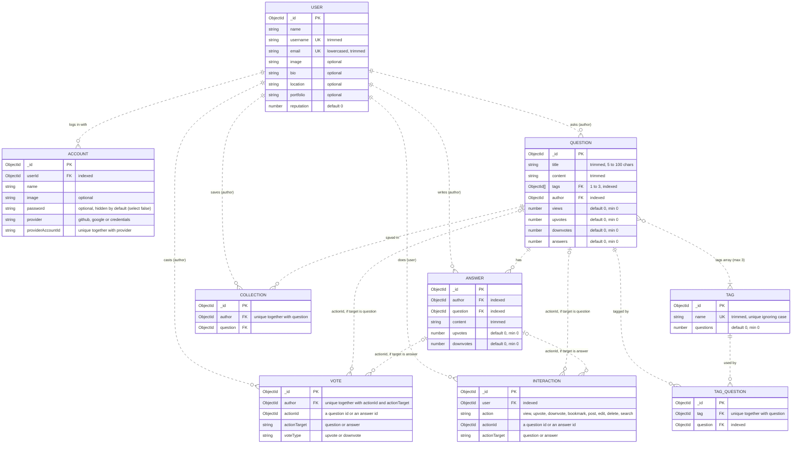

# Database model

DevFlow stores its data in MongoDB through Mongoose. Each model lives in
`database/*.model.ts`. Every document also gets `createdAt` and `updatedAt`
(`timestamps: true`) and Mongoose's version key `__v`. The diagram leaves
those out and only shows `_id`.

## Entity relationship diagram

### How to read it

- **Line ends:** `||` means exactly one, `|o` zero or one, `o{` zero or more,
  `|{` one or more. So `USER ||..o{ QUESTION` reads "a user asks zero or more
  questions; each question has exactly one author".
- **Dotted lines:** Mermaid draws a solid line when a child's identity depends
  on its parent. In MongoDB every document has its own `_id`, so none do, and
  every line is dotted.
- **Field markers:** `PK` is the primary key. `FK` is a reference to another
  model (`ref` in the schema). `UK` is unique on its own. A uniqueness that
  needs several fields together is written in the comment instead.
- **Required:** a field is required unless its comment says `optional` or
  gives a `default`.
- **Vote and Interaction:** `actionId` points at a question **or** an
  answer, and `actionTarget` says which. Each one points at exactly one of the
  two, which the diagram can't show, so it's drawn as two "zero or one" lines.
- **Nothing checks that a reference exists.** MongoDB has no foreign keys, so
  an `FK` here (or an `actionId`) can point at a deleted document. Deleting
  must clean up in code.

## The collections

| Model         | Collection     | One document is…                                       | Unique rule                                        |
| ------------- | -------------- | ------------------------------------------------------ | -------------------------------------------------- |
| `User`        | `users`        | A person and their profile.                            | `username`; `email`                                |
| `Account`     | `accounts`     | One way a user logs in (see `docs/AUTH.md`).           | `provider` + `providerAccountId`                   |
| `Question`    | `questions`    | A question, with counters for views, votes, answers.   | —                                                  |
| `Tag`         | `tags`         | A topic like `react`, with how many questions use it.  | `name`, ignoring case                              |
| `TagQuestion` | `tagquestions` | One link between a tag and a question.                 | `tag` + `question`                                 |
| `Answer`      | `answers`      | An answer to one question.                             | —                                                  |
| `Collection`  | `collections`  | A question a user saved (bookmarked).                  | `author` + `question` (save once)                  |
| `Vote`        | `votes`        | One user's up- or downvote on a question or answer.    | `author` + `actionId` + `actionTarget` (vote once) |
| `Interaction` | `interactions` | An activity log entry, used later for recommendations. | —                                                  |

## Design notes

- **Tag links are stored twice.** `Question.tags` holds the tag ids on the
  question, and `TagQuestion` holds the same links as separate documents. Both
  are indexed, so either can find "questions with this tag". Nothing in the
  schemas keeps them in step: the code that creates or edits a question must
  write both, in one transaction. `createQuestion`
  (`lib/actions/question.action.ts`) does this for new questions.
- **The 1–3 tag rule** is a validator on `Question.tags`. It counts ids, so it
  doesn't stop the same tag twice, and array updates like `$push` skip it. The
  code must check both: `AskQuestionSchema` rejects the same tag twice
  (ignoring case), and `createQuestion` saves the question with its tags in
  one `create`, so the validator runs.
- **Counters are copies.** `Question.answers`, `upvotes`, `downvotes` and
  `Tag.questions` could be counted from other collections. `views` can't:
  `Interaction` needs a user, so signed-out views leave no record and the
  counter is the only tally. They are stored so lists don't count on every
  page load, and the code must `$inc` them
  whenever the real data changes. `min: 0` runs on create, save and validated
  updates, but **never on `$inc`**, so a decrement must guard in its filter,
  e.g. `{ answers: { $gt: 0 } }`.
- **Case-insensitive tag names** use a collation index (`locale: "en"`,
  `strength: 2`). A query only uses it, and only ignores case, when it has the
  same `.collation(...)`.
- **Polymorphic references** (`Vote`, `Interaction`) have no `ref`, so
  `populate("actionId")` doesn't know which model to load. Check
  `actionTarget` first, then query `Question` or `Answer` (or populate with an
  explicit `model`).
- **Rules that live in code, not the schema:** passwords are bcrypt-hashed and
  only set on `credentials` accounts by the auth code. The provider's name is
  refreshed on the Account at each GitHub/Google sign-in, and its image too
  when the provider sends one, while the
  User keeps what the person set. See `docs/AUTH.md`.
